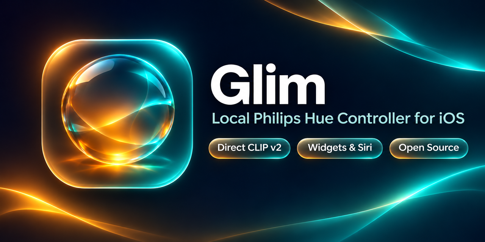
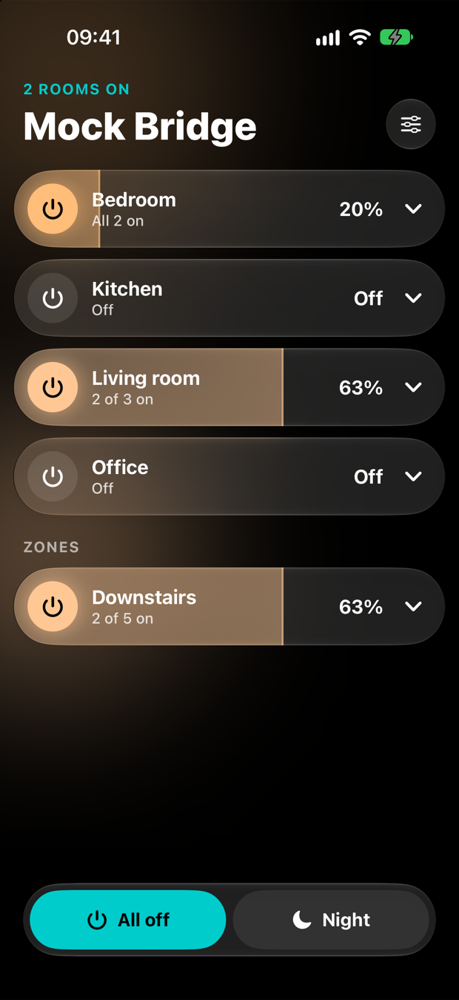
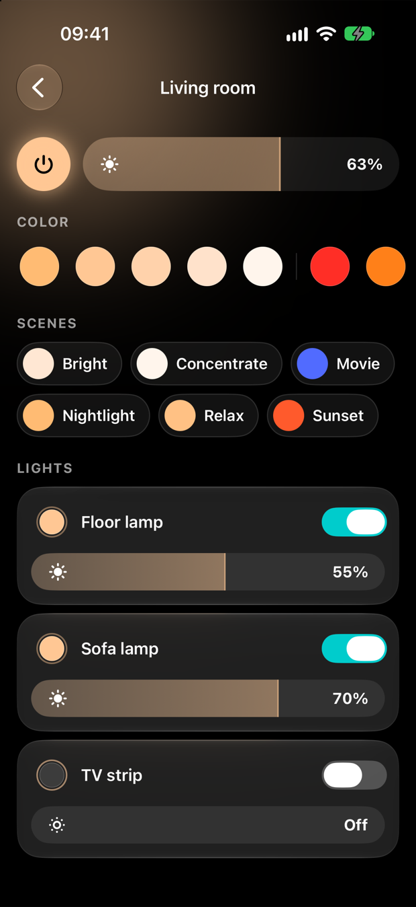
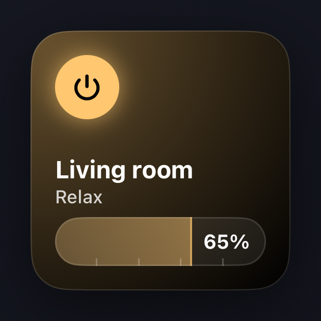
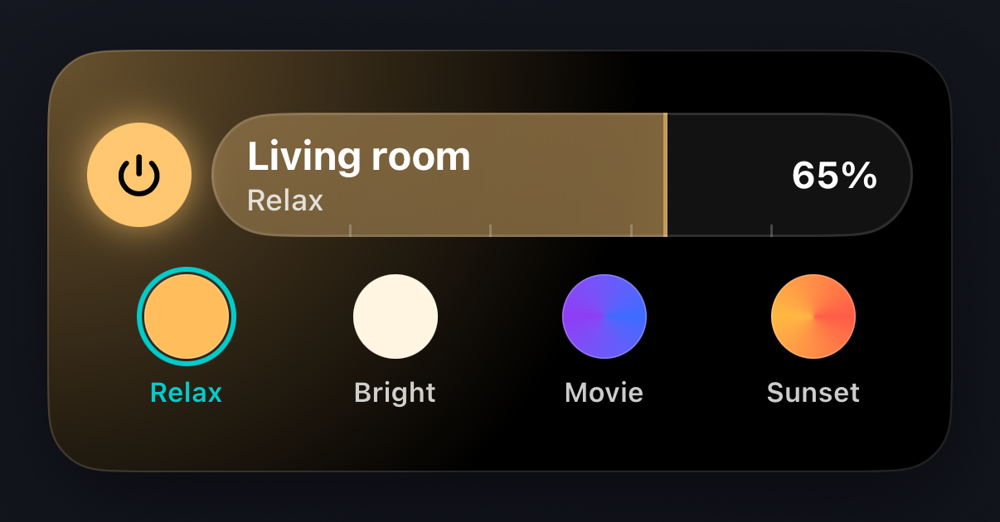
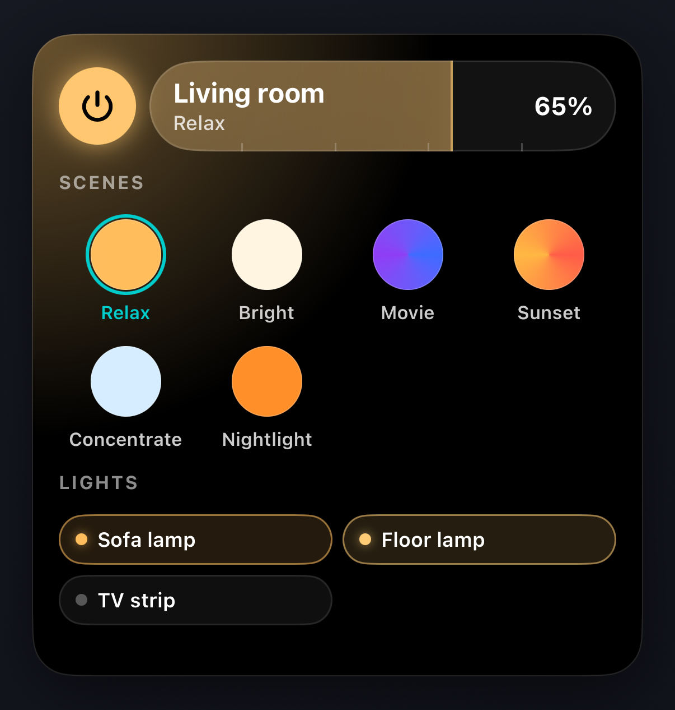

# Glim



Glim is an open-source, local-only Philips Hue controller for iPhone that speaks directly to your Hue bridge over CLIP v2 with no cloud account and no loading screens.

## Screenshots

| Home Screen (Rooms & Zones) | Room Detail (Scenes, Color & Lights) |
|---|---|
|  |  |

### Widgets

| Small | Medium | Large |
|---|---|---|
|  |  |  |

## Quickstart

Run Glim in the iOS Simulator against the bundled mock Hue bridge without touching real lights:

```bash
brew install xcodegen
python3 scripts/mock-bridge.py 8443 &
MOCK_PID=$!
xcodegen generate
xcodebuild -project Glim.xcodeproj -scheme Glim \
  -destination 'platform=iOS Simulator,name=iPhone 18 Pro,OS=27.2' \
  -derivedDataPath build CODE_SIGNING_ALLOWED=NO build
xcrun simctl boot 'iPhone 18 Pro'
xcrun simctl install booted build/Build/Products/Debug-iphonesimulator/Glim.app
SIMCTL_CHILD_GLIM_RESET=1 SIMCTL_CHILD_GLIM_BRIDGE_HOST=127.0.0.1:8443 \
  SIMCTL_CHILD_GLIM_BRIDGE_KEY=mock-application-key \
  xcrun simctl launch booted com.robinvivant.glim
# Stop mock bridge when finished: kill "$MOCK_PID"
```

Run the `HueKit` unit and mock-bridge HTTPS test suites:

```bash
# Unit tests
cd Packages/HueKit && swift test

# End-to-end HTTPS tests against the mock bridge
scripts/mock-bridge.py 8443 &
MOCK_PID=$!
cd Packages/HueKit && HUE_MOCK_HOST=127.0.0.1:8443 swift test
kill "$MOCK_PID"
```

## Key Capabilities

- **Full-Width Brightness Slider Rows:** Each room or zone row acts as a horizontal brightness slider with a quick power button, expandable scene dots, individual light toggles, and an always-dark palette with a teal accent (`#00CCCC`).
- **Cached Instant Startup & Live SSE Sync:** Launches immediately from the last cached home snapshot in the App Group container, applies touches optimistically, coalesces rapid slider drags per target, and follows the bridge's CLIP v2 Server-Sent Event stream.
- **Room & Light Controls:** Adjust room/zone brightness, white color temperature (mirek), XY gamut colors, and Philips Hue scenes, or switch everything off or activate Nightlight scenes across rooms in one tap.
- **Widgets, Control Center & Siri:** Includes Small, Medium, and Large Home Screen room widgets (power, 5/25/50/75/100% brightness steps, scenes, light toggles, deep links), Control Center / Lock Screen controls, and Shortcuts (`AllLightsOffIntent`, `ToggleRoomIntent`, `ActivateSceneIntent`).
- **Command-Line Companion (`huectl`):** Inspect bridges, rooms, lights, scenes, and live SSE events from macOS via `Packages/HueKit/Sources/huectl`.

## Install on an iPhone

**Prerequisites:** macOS 26+ with Xcode 27.2+ (Swift 6.0+ and iOS 18.0+ / iOS 27 SDK), an Apple Developer Team ID, and `xcodegen`.

1. Copy `Config/Local.xcconfig.example` to `Config/Local.xcconfig` (gitignored) and set `DEVELOPMENT_TEAM = YOUR_TEAM_ID`.
2. Connect your iPhone by cable with Developer Mode enabled (**Settings > Privacy & Security**), then run:

```bash
scripts/install.sh
```

3. On first launch, allow local network access and press the link button on your Hue bridge when prompted.

> Prebuilt unsigned `.ipa` archives are also published on [GitHub Releases](../../releases) for sideloading or re-signing with your own Apple Developer team.

## Architecture & Local Protocol

Glim talks directly to the Hue bridge over local HTTPS (CLIP v2) using `HueKit`:

- **Bridge Discovery:** Locates bridges via `_hue._tcp` Bonjour/mDNS and Philips' `discovery.meethue.com` endpoint, or accepts an explicit IP address.
- **TLS Certificate Pinning:** Because Hue bridges use self-signed certificates from Signify's private CA, pairing records the bridge certificate's SHA-256 fingerprint, verifies its subject names the bridge ID, and pins all future requests and SSE streams to that certificate.
- **Shared App Group Storage:** Bridge credentials and the home snapshot live in `group.com.robinvivant.glim` so the app and `GlimWidgets` share state locally.

## Repository Layout

| Path | Contents |
|---|---|
| `App/` | SwiftUI app (`GlimApp`, `HomeView`, `GroupDetailView`, `SetupView`, `Controls`) |
| `Packages/HueKit/` | Swift package for CLIP v2 client, pairing, discovery, SSE, command queue, `huectl` CLI, and unit/mock tests |
| `Shared/` | `Glim` constants and `AppIntents` compiled into both the app and widget extension |
| `Widgets/` | Home Screen room widgets and Control Center controls (`GlimWidgets`) |
| `UITests/` | XCUITest suite running the app and Home Screen widget against `mock-bridge.py` |
| `Config/` | Tracked `Base.xcconfig` and `Local.xcconfig.example` signing template |
| `scripts/` | Local HTTPS `mock-bridge.py`, device `install.sh`, and icon helper |
| `project.yml` | XcodeGen specification (`Glim`, `GlimWidgets`, `GlimUITests`) |

## Contributing, Security & License

- **Contributing:** See [CONTRIBUTING.md](CONTRIBUTING.md) for local setup, mock-bridge tests, and PR guidelines.
- **Security:** See [SECURITY.md](SECURITY.md) for TLS certificate pinning details and private vulnerability reporting.
- **Changelog:** See [CHANGELOG.md](CHANGELOG.md) for release history.
- **License:** Released under the [MIT License](LICENSE).
- **Trademarks:** Philips Hue and Signify are trademarks of Signify Holding; this project is not affiliated with Signify.
